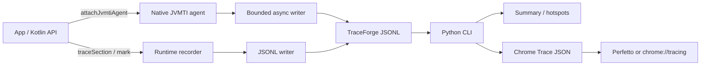

# TraceForge

### Friendly Runtime Trace & Profiling Agent for Android

[](https://github.com/abstractednick/TraceForge/actions/workflows/ci.yml)
[](https://github.com/abstractednick/TraceForge/actions/workflows/docs.yml)
[](https://www.python.org/)
[](traceforge-runtime/)
[](traceforge-agent/)
[](LICENSE)
[](#project-status)

**TraceForge** turns low-level Android/JVM runtime events into something developers can actually use:
a small Kotlin API, a defensive native JVMTI agent, structured JSONL traces, and a zero-dependency
CLI that validates, summarizes, and exports those traces for Perfetto or Chrome Tracing.

> Designed for **debug and profiling builds**. TraceForge is intentionally honest about overhead,
> drop-on-pressure behavior, and what is implemented versus planned. It is a portfolio-grade systems
> project, not a claim that it replaces Android Studio Profiler or production APM.

---

## Why TraceForge exists

Android already has powerful tools — JVMTI / ART TI, method tracing, Perfetto, Studio CPU & memory
profilers — but the day-to-day path from “something feels slow” to “here is a shareable, inspectable
artifact” is fragmented.

TraceForge focuses on one sharp workflow:

1. **Attach** a native agent with narrow, explicit options.
2. **Record** method and optional allocation events into bounded, crash-resistant JSONL.
3. **Annotate** critical app flows from Kotlin (`traceSection` / markers).
4. **Analyze** offline with a portable CLI — no proprietary cloud required.

```text
App code (Kotlin)
        │
        ▼
TraceForge Runtime  ──►  sections / markers / filters
        │
        ├── JVMTI Agent (native)  ──►  method + allocation events
        │         │
        │         ▼
        └── Trace storage (JSONL)
                  │
                  ▼
         TraceForge CLI  ──►  validate · hotspots · Chrome Trace
                  │
                  ▼
         Perfetto / chrome://tracing
```

---

## Highlights that show engineering depth

| Capability | What you get |
|---|---|
| **Defensive JVMTI agent** | Capability negotiation, package filtering, monotonic timestamps, graceful unload |
| **Bounded async writer** | Callbacks never wait on disk; overflow drops events and reports the count |
| **Kotlin runtime facade** | Lifecycle states, nested sections, markers, package/thread filters, sampling |
| **Zero-dep Python CLI** | Validation with line-level errors, hotspot ranking, Chrome Trace export |
| **Honest docs** | Status matrix, safety guidance, troubleshooting, trace schema, roadmap |
| **Automation** | CI for Python + native + Gradle (when wrapper present), Dependabot, templates |

---

## Architecture



**Design principle:** keep the hot path short. Agent callbacks enqueue and return. Analysis happens
off-device where richer tooling is cheap and safe.

Deep dive: [Architecture](docs/architecture.md) · [JVMTI setup](docs/jvmti-setup.md) · [Trace format](docs/trace-format.md)

---

## Quick start

### 1. Analyze a trace (no Android device required)

```bash
python3 -m venv .venv
source .venv/bin/activate
python -m pip install -e ./traceforge-cli

traceforge validate traceforge-cli/tests/fixtures/valid.jsonl
traceforge summary  traceforge-cli/tests/fixtures/valid.jsonl --top 5
traceforge chrome   traceforge-cli/tests/fixtures/valid.jsonl -o trace.chrome.json
```

Open `trace.chrome.json` in [Perfetto UI](https://ui.perfetto.dev/) or `chrome://tracing`.

### 2. Annotate critical paths in Kotlin

```kotlin
TraceForge.start(
    TraceForgeConfig(
        outputPath = Paths.get("traces", "checkout.jsonl"),
        includedPackagePrefixes = setOf("com.example.app"),
        bufferCapacity = 16_384,
        samplingRate = 1.0,
    )
)

try {
    traceSection("checkout_flow") {
        // critical business logic
        TraceForge.mark("payment_submitted")
    }
} finally {
    TraceForge.stop()
}
```

### 3. Attach the native agent on Android 8.0+

```kotlin
Debug.attachJvmtiAgent(
    "/data/user/0/$packageName/code_cache/libtraceforge-agent.so",
    "output=/data/user/0/$packageName/files/trace.jsonl," +
        "methods=true,allocations=false,include_package=com.example,max_events=8192",
    classLoader,
)
```

See the [sample integration](traceforge-sample/) and [JVMTI setup guide](docs/jvmti-setup.md).

---

## Trace format & CLI output

Events are **one JSON object per line** — easy to stream, easy to `grep`, easy to review in PRs:

```json
{"type":"method_entry","timestamp_ns":1010000,"thread":"main","class":"Lcom/example/Checkout;","method":"submit","signature":"()V"}
{"type":"method_exit","timestamp_ns":1110000,"thread":"main","class":"Lcom/example/Checkout;","method":"submit","signature":"()V"}
{"type":"allocation","timestamp_ns":1120000,"thread":"main","object_class":"Ljava/lang/String;","size_bytes":64}
```

```text
$ traceforge summary trace.jsonl --top 5
Events:      3
Threads:     1
Time span:   110.000 µs
Allocations: 64 bytes
Unmatched:   0 entries, 0 exits
Event types: allocation=1, methodEntry=1, methodExit=1

Hotspots (inclusive):
 1.   100.000 µs      1 calls  Lcom/example/Checkout;.submit
```

The CLI also accepts legacy camelCase aliases (`methodEntry`, `timeNs`, `threadId`, `sizeBytes`)
for compatibility. Full schema: [docs/trace-format.md](docs/trace-format.md).

---

## Repository map

```text
TraceForge/
├── traceforge-runtime/   # Kotlin JVM API: config, lifecycle, sections, hotspots
├── traceforge-agent/     # C++17 JVMTI shared library + portable writer tests
├── traceforge-cli/       # Zero-dependency Python analyzer & Chrome exporter
├── traceforge-sample/    # Illustrative Android attach + Kotlin section usage
├── docs/                 # Architecture, setup, schema, practices, troubleshooting
└── .github/              # CI, Dependabot, issue & PR templates
```

| Path | Role |
|---|---|
| [`traceforge-runtime/`](traceforge-runtime/) | Thread-safe Kotlin facade with filters, sampling, and overflow strategies |
| [`traceforge-agent/`](traceforge-agent/) | Native method/allocation hooks and bounded async JSONL writer |
| [`traceforge-cli/`](traceforge-cli/) | `validate` · `summary` · `chrome` with unit-tested fixtures |
| [`traceforge-sample/`](traceforge-sample/) | Debuggable-app attach pattern and scenario annotations |
| [`docs/`](docs/overview.md) | Recruiter- and contributor-ready technical writing |

---

## Project status

| Area | Status | Notes |
|---|---|---|
| Native method entry/exit | **Implemented** (experimental) | Optional package-prefix filter |
| Native allocation callbacks | **Implemented** (opt-in) | High overhead; off by default |
| Bounded JSONL writer | **Implemented** | Reports dropped events at shutdown |
| Python validation & hotspots | **Implemented** | Standard library only |
| Chrome Trace export | **Implemented** | Opens in Perfetto / Chrome tracing |
| Kotlin runtime facade | **Implemented** (API may evolve) | Sections, markers, filters, sampling |
| Android packaging / Gradle sample app | **Planned** | Sample source is illustrative |
| In-app HUD / ProfilingManager / production collection | **Planned** | Not claimed as present |

---

## Performance & safety

TraceForge follows the same discipline you would expect from production instrumentation:

- Enable only in **debuggable / profileable** builds.
- Prefer a **narrow** `include_package` / package-prefix filter.
- Keep **allocations off** until you need them.
- Cap pressure with `max_events` / `bufferCapacity` and inspect drop diagnostics.
- Treat traces as potentially sensitive — they contain class, method, and thread names.
- Compare short, representative scenarios across multiple runs; TraceForge reports observed
  wall-clock intervals, not statistically rigorous CPU profiles.

More: [Best practices](docs/best-practices.md) · [Troubleshooting](docs/troubleshooting.md) · [Security](SECURITY.md)

---

## Documentation index

| Document | Audience |
|---|---|
| [Overview](docs/overview.md) | Anyone landing on the project |
| [Architecture](docs/architecture.md) | Engineers reviewing design choices |
| [JVMTI setup](docs/jvmti-setup.md) | Native / Android integration |
| [Trace format](docs/trace-format.md) | Tooling authors & CLI users |
| [Best practices](docs/best-practices.md) | Teams adopting TraceForge carefully |
| [Troubleshooting](docs/troubleshooting.md) | First-hour debugging |

---

## Roadmap

1. Stabilize the runtime ↔ agent contract and Android ABI packaging.
2. Add on-device integration tests and quantified overhead benchmarks.
3. Improve pairing diagnostics for lost or interleaved events.
4. Enrich Chrome Trace metadata (process/thread naming, section nesting).
5. Evaluate Perfetto-native export and carefully scoped production profiling.

---

## Contributing

Please read [CONTRIBUTING.md](CONTRIBUTING.md) and the [Code of Conduct](CODE_OF_CONDUCT.md).
Useful bug reports include Android version, ABI, attach method, sanitized agent options, and the
first relevant `TraceForge` log line.

## License

Licensed under the [Apache License 2.0](LICENSE).

---

<p align="center">
  <sub>
    TraceForge — forge usable insights from low-level runtime traces.
  </sub>
</p>
